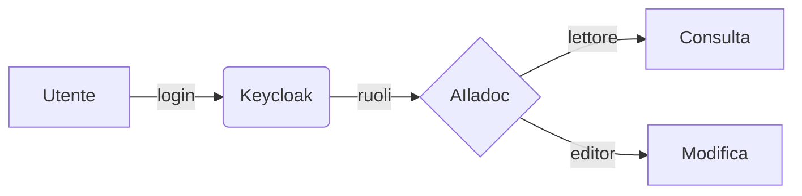

# Scrivere in Markdown

Le pagine supportano le stesse estensioni di **MkDocs Material**, quindi puoi riusare documentazione esistente.

## Riquadri

!!! note "Nota"
    Un riquadro informativo.

!!! warning "Attenzione"
    Qualcosa a cui fare caso.

??? question "Riquadro richiudibile"
    Il contenuto appare cliccando sul titolo.

## Schede

=== "Python"

    ```python
    def saluta(nome: str) -> str:
        return f"Ciao {nome}!"
    ```

=== "JavaScript"

    ```js
    const saluta = (nome) => `Ciao ${nome}!`;
    ```

## Checklist

- [x] Scrivere la bozza
- [x] Farla rivedere
- [ ] Pubblicare

## Diagrammi



## Immagini

Nell'editor il pulsante **immagine** della barra chiede la dimensione (*Piccola*, *Media* o *Grande*) e poi il file; puoi anche trascinare o incollare un'immagine nel testo. Il file viene salvato nella cartella della pagina. Per cambiare la dimensione in seguito passa il mouse sull'immagine nell'anteprima, oppure metti il cursore sull'immagine nel testo e riapri il pulsante.

Nel Markdown la dimensione è una classe tra graffe, subito dopo l'immagine:

```markdown
{ .img-piccola }
{ .img-media }
{ .img-grande }
```

| Classe | Larghezza |
|--------|-----------|
| `.img-piccola` | circa un terzo della pagina: due o tre stanno sulla stessa riga |
| `.img-media` | circa due terzi della pagina |
| `.img-grande` | tutta la larghezza |

Senza classe l'immagine resta alla sua dimensione naturale, mai più larga della pagina.

## Altro

Testo ==evidenziato==, ~~barrato~~, tasti ++ctrl+alt+del++, note a piè di pagina[^1].

[^1]: Proprio come questa.
