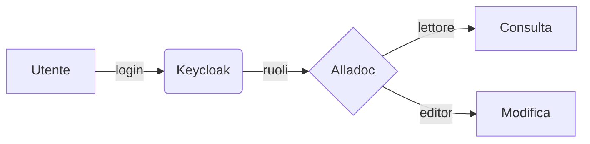

# Scrivere in Markdown

Le pagine supportano le stesse estensioni di **MkDocs Material**, quindi puoi riusare documentazione esistente.

## Riquadri

!!! note "Nota"
    Un riquadro informativo.

!!! warning "Attenzione"
    Qualcosa a cui fare caso.

??? question "Riquadro richiudibile"
    Il contenuto appare cliccando sul titolo.

## Schede

=== "Python"

    ```python
    def saluta(nome: str) -> str:
        return f"Ciao {nome}!"
    ```

=== "JavaScript"

    ```js
    const saluta = (nome) => `Ciao ${nome}!`;
    ```

## Checklist

- [x] Scrivere la bozza
- [x] Farla rivedere
- [ ] Pubblicare

## Diagrammi



## Altro

Testo ==evidenziato==, ~~barrato~~, tasti ++ctrl+alt+del++, note a piè di pagina[^1].

[^1]: Proprio come questa.
